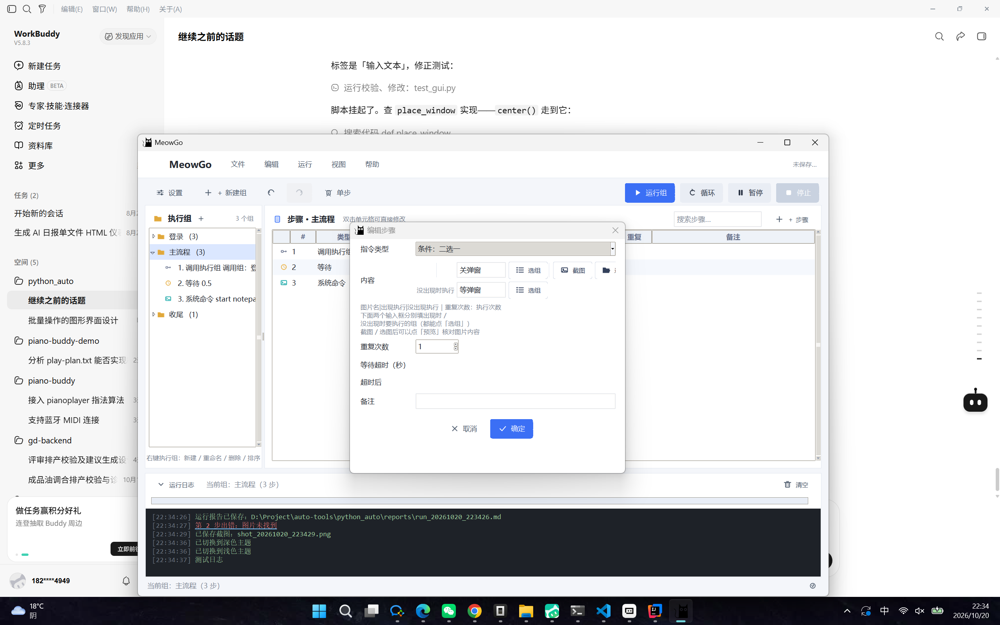

# MeowGo

把原来「手动编辑 `cmd.xls` + 命令行按 enter」的流程，改成**在界面上直接配置步骤并执行**。
识别点击、热键、输入、系统命令等能力与旧版完全一致，并且仍然兼容旧版 `cmd.xls`。

新版把步骤装进**可复用的执行组**：左侧维护组，右侧编辑组里的步骤，组与组之间可以互相调用。
界面上没有「项目」概念——**所有执行组自动保存**（`rpa_settings.json`），下次打开还在。

在旧版能力之外，还加了这些**降低门槛**的东西：条件步骤、窗口操作、坐标点击/拾取、
变量传递、拖拽、宏录制（真实鼠标操作录成步骤）、数据驱动（一份流程跑多批数据）、
定时运行、运行报告、撤销重做、图片管家、配置备份，以及不开界面的命令行模式。

界面体验上还有这些**好用的小东西**：运行进度条与迷你置顶条、步骤搜索、斑马纹与
类型徽章、图片预览窗格与对话框预览按钮、深色主题、步骤批量多选、拖拽落点指示线、单步调试。



## 快速开始

```bat
:: 1. 安装依赖（只需一次）
pip install -r requirements.txt

:: 2. 启动（推荐双击 启动GUI.bat，不会出现黑色控制台）
python start-app.py
```

如果你已经在用旧版并且装好了 `pyautogui / xlrd / pillow / opencv-python`，可以跳过第 1 步。

## 界面说明

```
菜单栏   MeowGo | 文件 / 编辑 / 运行 / 视图 / 帮助（自绘，与右键菜单同款下拉）
工具栏   ⚙ 设置 | … ▶运行组  循环  暂停  停止（导入/导出 Excel 在菜单栏「文件」里）
左 栏    执行组（文件夹式，可展开看组里的步骤；按住可拖拽调整顺序，有蓝色落点线指示插入位置）
右 栏    当前组的步骤列表（双击单元格即可修改；行可拖拽排序；支持多选批量操作；顶部有搜索框）
下 方    运行日志（可收起）+ 进度条 + 状态栏
```

标题栏的图标用的是程序自带的 `main.png`（窗口、任务栏、标题栏同一个图标）。

组和步骤的增删改移**都放在右键菜单里**（自绘的圆角菜单，与界面同风格，
带图标、快捷键提示；当前不可用的项会自动变灰）：

- 在**左栏的组**上右键：运行这个组 / 循环运行 / 新建 / 重命名 / 复制为副本 / 上移 / 下移 / 删除；
- 在**右栏的步骤**上右键：新增 / 编辑 / 复制 / 截取屏幕替换图片 / 上移 / 下移 / 删除；
- 顶部菜单栏（文件 / 编辑 / 运行 / 视图 / 帮助）提供同样的功能，展开后按钮会高亮；
- 菜单弹出后，**在别处（哪怕是别的程序窗口）点一下左键就会收起**；
- 在菜单外**点右键**时会收起当前菜单，并就地弹出指针下面那块的菜单
  （比如正开着「文件」下拉时，在步骤列表上右键会直接换成步骤菜单）。
- 组和步骤都支持**拖拽排序**：按住某一行拖到目标行松开即可（把组拖到另一个组
  展开后的某条步骤上，就会归入那个组——用来整理大流程很好用）。

### 界面体验改进

**运行进度**：

- 日志区上方有**进度条**：带数据运行时显示「第 x/y 行」，循环/调用次数已知时显示步数；
  循环次数未知（`-1`）时是**脉冲动画**，告诉用户「还在跑，没卡死」；
- 可选**迷你置顶进度条**（设置里勾「运行时显示迷你进度条」）：一条小小的置顶条，
  窗口最小化时也能看到整体进度，跑完自动消失；
- 步骤列表会**高亮当前执行行**，跑完的成功/失败行分别染成绿/红色。

**步骤搜索**：步骤列表顶部的搜索框，按「步骤名或内容」实时过滤，
右上角显示 `命中数/总数`；`Esc` 清空。步骤多的时候不用滚屏找。

**斑马纹与类型徽章**：步骤列表隔行浅色条纹，配合类型列的小色块，
长列表看起来不累、找行更快（颜色随深浅主题自动切换）。

**图片预览窗格**：选中图片类步骤（单击/双击/右键/条件）时，列表下方直接显示
缩略图、文件名和尺寸，点「在文件夹中显示」跳到原图——不用打开图片目录翻。

**对话框图片预览**：新增/编辑步骤的对话框里，「截图」「选图」旁边就是「预览」按钮，
点开按窗口大小**整图查看**当前内容框里的图片（附原始尺寸、文件大小、在文件夹中显示），
截图或选图后可以立刻核对截得对不对，不用先保存再跑一次看效果。

**深色主题**：菜单「视图 → 切换到深色主题」或 `Ctrl+D`，整站（菜单、列表、
对话框、按钮、图标）一起换肤，选择会被记住，下次打开还是深的。

**批量操作**：步骤列表支持 `Ctrl` / `Shift` **多选**（或 `Ctrl+A` 全选），
右键菜单可对选中的一批步骤**批量复制 / 删除 / 上移 / 下移**（整块移动，保持相对顺序）。

**拖拽落点指示线**：拖拽排序时跟手显示一条蓝色细线，标出松手后会插到哪一行；
拖到最后一行下方会排到列表末尾，不用瞄像素。

**单步调试**：菜单「运行 → 单步调试开关」或 `F8` 打开调试模式（或右键组 →
「单步调试运行这个组」跑一次）。开启后每一步执行前都会弹出确认框：
**运行**继续、**跳过**跳过这步、**停止**中止整场——配合运行报告能快速定位是哪一步出问题。

**启动预热**：首次运行如果还没加载过识别引擎，第一步可能要等一二十秒
（底层是 OpenCV 首次导入）。程序会在启动时**后台预热**，第一步不再干等。

### 执行组与复用

- 界面以**执行组**为单位：运行、暂停、停止都作用在当前选中的组上。
- 想复用别的组：在某个组里新增一条 **调用执行组** 指令，内容填目标组名即可；
  重复次数写 `3` 就调用 3 次，写 `-1` 就是一直调用。
- 运行前会自动校验：调用的组是否存在、是否存在**循环调用**（A 调 B、B 又调 A）、
  内容格式是否合法，有问题会弹窗并写进日志。
- 改组名时会自动更新所有指向它的调用指令。
- 左侧点开某个组可以看到它的步骤（只读概览）；点其中一条会跳到右侧对应行。

### 配置一条步骤

- **新增**：在右侧列表里右键 →「新增步骤…」→ 选类型 → 填内容 → 确定；
- **修改**：在列表里**双击单元格**直接改（类型列是下拉框），或选中行按 `F2` 开对话框；
- **图片类步骤**（单击/双击/右键）：在对话框点 **截图** 框选屏幕按钮，或点 **选图** 选已有 png；
  也可以选中列表里的图片步骤，右键 →「截取屏幕并替换图片…」直接替换；
- **排序 / 复制 / 删除**：同样在步骤的右键菜单里（快捷键 `Delete` 删除、`Ctrl+Enter` 新增）。

### 等不到图片怎么办：超时与失败策略

图片类步骤（单击/双击/右键/条件）在对话框里多了两个选项，**不填就是旧行为**：

- **等待超时（秒）**：`0` = 一直等（默认，与旧版一致）；填正数则最多等这么久；
- **超时后**：`跳过这步`（默认，记一次失败后继续往下跑）或 `停止执行`（立即中止整场）。

「跳过」的步骤在日志和运行报告里都会标成失败，跑完一眼能看到是哪几步没等到。

### 坐标步骤：不用截图，直接点位置

- **坐标点击**（`click_xy`）：内容写 `x,y`，如 `500,300`；加第三段 `,right` 表示右键；
  重复次数照常生效（填 `2` 就是连点两下）；
- **移动鼠标**（`move_xy`）：只把鼠标移到 `x,y`，不点击；
- 对话框里点 **拾取** 按钮：有 3 秒倒计时，期间把鼠标挪到目标位置再点一下左键，
  坐标自动填好（按 `Esc` 取消）。

### 条件步骤：屏幕上出现图片才执行

- **条件：出现图片则执行**（`if_image`）：内容写 `图片名|组名`，如 `弹窗.png|关闭弹窗`；
  运行时先找图片，**找到了就调用指定组**，找不到就跳过（不报错）；
- 对话框里填好图片名后，点 **选组** 按钮会弹出全部组名的菜单，选一个即可，
  不用手打组名（打错了运行时会提示找不到执行组）。

### 窗口操作

- **窗口操作**（`window`）：三种写法——
  - `activate:标题`：把标题包含这段文字的窗口激活并带到前台（最小化会自动还原）；
  - `wait:标题|秒`：等窗口出现（默认 5 秒，可自己填），出现了就激活；
  - `close:标题`：给窗口发关闭消息。
- 适合「先激活目标软件再操作」「等某个窗口弹出来」这类场景；
  等待超时会报错并中止整场执行（报告里能看到是哪一步）。

### 宏录制：把真实鼠标操作录成步骤

菜单「编辑 → 宏录制鼠标操作…」（或工具栏）：

1. 点开始后**正常操作鼠标**——单击、双击、右键、滚轮、拖拽都会被记下来；
2. 控制条自己区域内的点击不会录进去（免得录到「停止」按钮本身）；
3. 点 **停止** 生成步骤（自动接在当前组步骤列表末尾），或 **取消** 放弃；
4. 录出来的内容：`click_xy`（含双击合并、右键）、`move_xy`（位移超过 60px 才记，
   免得满屏都是移动）、`scroll`（滚轮按格记，100 = 1 格）。

录制走的是 Windows 底层鼠标钩子，**录的是真实操作**，与识图点击可以混着用。

> 说明：合成注入的鼠标移动不过底层钩子，所以宏录制只响应真实硬件操作——
> 这正是它该有的样子。

### 热键步骤：直接按按键录入（推荐）

配「热键组合」时不用再对着输入法敲 `ctrl,s`——点内容框右侧的 **⌨ 按键录入** 按钮
（或双击热键步骤的内容列，点那个小键盘按钮），然后**直接按下组合键**：

- 按下 `Ctrl+Shift+A` → 全部松开，自动写入 `ctrl,shift,a`（修饰键自动排在前）；
- 录的是**原始按键**，中文输入法开着也不怕——逗号不会被输入法变成全角「，」，
  字母也不会掉进输入法候选里；录制期间按键被临时接管，不会漏进别的控件；
- **小键盘数字**会自动写成 `num0~num9`（引擎只认这种写法）；
- 单独按 `Esc` 取消录入，恢复原来的内容；录完还能继续手动改；
- 在列表里双击热键步骤的内容列，同样有这个按钮。

> 旧版限制：引擎不识别**顶层数字键**（`1`~`0` 那排），需要数字时请按小键盘数字键，
> 误按了会有提示。热键最多 10 个按键。

### 管理执行组

- 在左侧组上右键：新建 / 重命名 / 复制为副本 / 上移 / 下移 / 删除（快捷键 `Ctrl+G` 新建组）。
- 展开组可以看到它包含的步骤；点其中任意一条会跳到右侧对应行。

### 数据驱动：一份流程跑多批数据

同一条流程，对着一张表逐行跑，内容里的 `{占位符}` 会替换成当前行的值：

- **准备数据**：CSV 或 Excel（第一行是表头，如 `名字,密码`），行数不限；
- **写占位符**：步骤内容里写 `{列名}`（对应表头列）、`{index}`（当前行号，从 1 开始）、
  `{date}`（今天日期）、`{time}`（当前时刻）、`{random}`（4 位随机数）、
  `{变量名}`（「设置变量 / 复制到变量」存下的值，见下文「变量」一节）；
  列和变量都不存在时**保留原样**，方便发现拼写错误；
- **跑法**：
  - 界面：菜单「运行 → 带数据运行…」选文件；
  - 命令行：`python start-app.py --run 组名 --data 数据.csv`；
- 日志里会有「—— 第 2/5 行 ——」的分隔，运行报告里每步都带**行号**。

例：数据表有 `名字` 列，流程里写一步「输入文本 → 你好{名字}」，
5 行数据就会依次输入「你好甲 / 你好乙 / …」。

### 编辑辅助：撤销重做 / 配置备份 / 图片管家

- **撤销 / 重做**：`Ctrl+Z` / `Ctrl+Y`（菜单「编辑」里也有）。新增、改名、删除、
  移动、内联修改、导入 Excel、宏录制、恢复备份**全部可以撤销**（最多 50 步）；
- **配置备份**：每次保存前会自动把上一版配置复制到 `backups/`（留最近 10 份）。
  菜单「文件 → 从备份恢复…」可以挑一份恢复，双击即可；
- **图片管家**（菜单「视图 → 图片管家…」）：一张表列出所有 png 及**被哪些步骤引用
  （引用几次）**。支持：
  - **重命名**：所有引用它的步骤会自动跟着改，不会断；
  - **清理未引用**：列出没人用的图，确认后删除（释放 `images/` 空间）；
  - 顺带显示文件大小，找大图很方便。

### 执行

- **运行组**：执行当前选中的组（`F5`，或在组上右键 →「运行这个组」）；
  **循环**：反复执行直到停止；菜单「运行 → 运行全部组」按左侧顺序跑所有组。
- 点运行后会先弹出倒计时，倒计时结束窗口自动最小化（避免遮挡识别区域）。
- 运行中会高亮当前正在执行的那一行，日志里能看到「▶ 进入执行组「X」」的嵌套过程。
- 停止方式：
  - 按 **F9**（全局热键，任何窗口下都有效）；
  - 或把鼠标快速甩到**屏幕左上角**（pyautogui 的 failsafe，会立即中断并报错）；
  - 或用「暂停」临时挂起。

### 定时运行与完成通知

菜单「运行 → 定时运行…」：

- **启用开关**打开后，填**时:分**（24 小时制），选要跑的组，到点自动执行；
- 可选**提示音**（跑完响一声）和 **Webhook**（跑完往你填的地址 POST 一条 JSON，
  方便接到企业微信 / 钉钉 / 飞书的机器人）；
- 同一天同一个时刻只会触发一次，第二天到点继续；组被删了会只在日志里提醒，不弹窗打扰；
- 到点时如果界面正忙（比如手抖在跑别的组），会跳过这一次，不会有两个流程抢鼠标。

### 运行报告与日志导出

- 每跑完一次（无论成功失败），都会在程序目录 `reports/` 下写一份
  `run_日期_时间.md`：结果、步数、失败数、总耗时、数据行数，以及**每一步**的
  组名 / 行号 / 类型 / 内容 / 耗时 / 成败；
- 菜单「文件 → 打开运行报告目录」直接打开这个文件夹；
- 菜单「文件 → 导出日志…」把当前日志窗的内容存成文本文件，出问题甩给别人看。

### 快捷键

| 按键 | 作用 | 按键 | 作用 |
|---|---|---|---|
| `Ctrl+G` | 新建执行组 | `Ctrl+Enter` | 新增步骤 |
| `F2` | 编辑选中的步骤 | `Delete` | 删除选中的步骤 |
| `F5` | 运行当前组 | `F9` | 停止（全局有效） |
| `Ctrl+Z` | 撤销 | `Ctrl+Y` | 重做 |
| `Ctrl+A` | 全选步骤（配合批量操作） | `F8` | 单步调试开关 |
| `Ctrl+D` | 切换深色 / 浅色主题 | | |

## 指令类型对照（与旧版 Excel 编号一致）

| Excel 第1列 | 类型 | 内容写法 |
|---|---|---|
| 1 | 左键单击 | 图片文件名，如 `按钮.png` |
| 2 | 左键双击 | 图片文件名 |
| 3 | 右键单击 | 图片文件名 |
| 4 | 输入文本 | 要输入的文字（走剪贴板粘贴） |
| 5 | 等待 | 秒数，如 `1.5` |
| 6 | 滚轮 | 距离，正数向上、负数向下，如 `-200`（100 = 1 格） |
| 7 | 热键组合 | 英文逗号分隔，如 `ctrl,s` 或 `win,r`；也可用「按键录入」直接按 |
| 8 | 粘贴当前时间 | 固定填 `当前时间` |
| 9 | 系统命令 | CMD 命令，如 `start notepad` |
| 10 | 调用执行组 | 要调用的组名（新版扩展，实现步骤复用） |
| 11 | 条件：出现图片则执行 | `图片名\|组名`，如 `弹窗.png\|关闭弹窗` |
| 12 | 窗口操作 | `activate:标题` / `wait:标题\|秒` / `close:标题` |
| 13 | 坐标点击 | `x,y`，如 `500,300`；加 `,right` 表示右键 |
| 14 | 移动鼠标 | `x,y`，如 `500,300`（只移动，不点击） |
| 15 | 条件：没出现图片则执行 | `图片名\|组名`，如 `错误.png\|重试` |
| 16 | 条件：二选一 | `图片名\|出现执行\|没出现执行` |
| 17 | 条件：窗口存在则执行 | `窗口标题\|组名`，如 `记事本\|处理` |
| 18 | 设置变量 | `变量名=值`，如 `订单号={index}` |
| 19 | 复制选中文字到变量 | `变量名`，如 `订单号` |
| 20 | 拖拽 | `起点\|终点`，各自是图片名或 `x,y`，如 `文件.png\|回收站.png` |

热键注意事项（沿用旧版限制）：最多 10 个按键；单个数字键不识别（用 `num0` 这类写法）；
英文逗号是分隔符，不能作为按键本身。

> 新版类型（11~20）只在界面上用编号兼容 Excel 导入导出；`超时/超时后` 参数
> 只存在 JSON 里，Excel 仍保持四列，旧表可以继续直接导入。

### 条件、变量与拖拽（类型 15~20）

- **条件：没出现图片则执行**（`if_not_image`）：`if_image` 的反面——屏幕上
  **没有**这张图时才调用指定组。适合「错误弹窗没出现才算成功」这类判断；
- **条件：二选一**（`if_else`）：`图片名|出现时执行的组|没出现时执行的组`，
  对话框里有两个「选组」按钮分别填；「没出现」的组留空表示什么都不做；
- **条件：窗口存在则执行**（`if_window`）：按标题子串找窗口，存在才调用组
  （只判断，不激活；要激活用「窗口操作」）；
- **拖拽**（`drag`）：`起点|终点`，两端各自写图片名或 `x,y`——混搭也行
  （如 `文件.png|800,600`）。截图 / 选图 / 拾取会填进第一个空着的一段；
  两端都就位后才按下鼠标，等不到会按「超时后」策略处理，不会把界面卡在
  拖拽状态里。

### 变量：把上一步的结果交给下一步

「设置变量 / 复制选中文字到变量」让流程有了**记忆**：

- **设置变量**（`set`）：`变量名=值`，值里可以用占位符，如 `行号={index}`、
  `名字={数据表里的列名}`；
- **复制选中文字到变量**（`copy`）：先手动选中文字，这一步替你按一次 `Ctrl+C`，
  把剪贴板内容存进变量（你原来的剪贴板内容之后会还原，不会被破坏）；
- **读回**：之后任意步骤的内容里写 `{变量名}` 即可，如「输入文本」写 `订单号是{订单号}`；
- **作用范围**：一场运行内有效——`run()` 开始时清空，之后同一次运行里的
  所有组、所有数据行、所有循环轮次共享；带数据跑时每行都会覆盖上一行的值；
- **优先级**：`{名字}` 这样的占位符，先查数据列、再查变量，都找不到才保留原样
  （方便发现拼写错误）；`{index}` / `{date}` / `{time}` / `{random}` 始终是内置含义。

例：数据表有 `订单号` 列，流程写「设置变量 当前单号={订单号}」→「单击 查询.png」→
「输入文本 {当前单号}」→「复制选中文字到变量 结果」，就能把每行的查询结果
存进变量，最后一步「输入文本 结果：{结果}」汇总输出。

## 与 Excel 互转

一个工作表 = 一个执行组，表头固定为 `指令类型 / 内容 / 重复次数(-1无限) / 备注`。

- **导入单个组**：菜单「文件 → 导入 Excel（单个组）」→ 导入为单个执行组（只取第一个工作表，按文件名命名）；
- **导入全部**：菜单「文件 → 导入 Excel（全部工作表）」→ 导入全部工作表（每个工作表一个组，组名 = 工作表名）；
- **导出当前组**：菜单「文件 → 导出当前组为 Excel」→ 导出当前组（单个工作表）；
- **导出所有组**：菜单「文件 → 导出所有组为 Excel」→ 导出所有组（多工作表，工作表名 = 组名）；
- 支持 `.xls`（旧版 `cmd.xls` 也能直接导入）与 `.xlsx`，工作表名里的非法字符会自动清理；
- **状态文件**：程序目录下的 `rpa_settings.json` 会实时保存所有执行组 + 图片目录 + 运行设置，
  不需要手动保存；旧版只有单一列表的 json 也能读入（会变成「默认组」）。

首次运行时的「图片目录」默认为程序目录下的 `images/`，可在「设置」里改，或菜单「文件 → 打开图片目录」直接打开。

## 图片素材怎么截才好

识别用的是模板匹配，**截取的区域要在整屏内唯一**：

- 只截按钮中间的一段（不要把旁边相似按钮一起框进去）；
- 不要截到会变化的内容（数字、光标、进度条、动画）；
- 同一张图在屏幕上出现多次时，程序会命中**最左上的一个**；
- 识别不出来时，把「设置 → 图片相似度」从 `0.9` 调到 `0.85` 再试。

## 常见问题

| 现象 | 处理 |
|---|---|
| 提示缺少依赖 | 照弹窗里的命令 `pip install ...` 安装，或双击 `启动GUI.bat` 自动装 |
| 图片识别不到 | 重新截图、缩小区域、降低相似度；确认运行时窗口已最小化 |
| 点击位置偏移 | 程序已声明 DPI 感知，请勿在多显示器缩放不同的情况下跨屏识别 |
| 提示「循环调用」 | 组之间互相调用成了环，去掉其中一条调用即可 |
| 停不下来 | 按 F9，或鼠标甩到屏幕左上角 |
| 滚轮滚不动 | 内容按「100 = 1 格」写（如 `200` = 2 格），程序会换算成系统认识的增量 |
| 定时没跑 | 定时运行只在界面开着时有效；同一天同一时刻只跑一次 |
| Win7 报错 | 安装 `WIN7补丁/windows6.1-kb2533623` |

## 无头运行（不开界面）

界面里配好的组，可以直接在命令行跑——适合接计划任务 / CI / 远程服务器：

```bat
:: 看看有哪些组
python start-app.py --list

:: 跑指定的组
python start-app.py --run 主流程

:: 按左侧顺序跑所有组
python start-app.py --all

:: 循环跑（Ctrl+C 停）
python start-app.py --run 主流程 --loop

:: 带数据跑：CSV/Excel 第一行是表头，每行跑一遍
python start-app.py --run 群发流程 --data 通讯录.csv

:: 报告写到指定目录（默认 reports\）
python start-app.py --run 主流程 --report D:\logs
```

跑完会在报告目录里生成 `run_日期_时间.md`（内容与界面运行报告一致），
控制台里也能看到每一步的日志。运行前会先校验步骤格式和图片文件是否存在。

## 目录结构

```
start-app.py          入口（检查依赖 → 声明 DPI 感知 → 启动界面；也支持 --run 等无头参数）
启动GUI.bat           双击启动（自动装依赖，用 pythonw 无控制台）
rpa/engine.py         执行组 / 步骤模型 / Excel 读写 / 数据驱动 / 变量 / 条件与拖拽 /
                      校验 / 执行引擎（可独立使用）
rpa/gui.py            界面：自绘菜单栏与菜单、组树、步骤列表、对话框、运行控制、
                      宏录制 / 定时运行 / 撤销重做 / 图片管家 / 备份恢复 /
                      深色主题 / 单步调试 / 批量操作 / 进度与搜索
rpa/uikit.py          矢量图标 + 圆角按钮 + 圆角菜单等自绘组件
rpa/assets.py         区域截图与图片路径解析
tests/test_engine.py  引擎单元测试（37 项，无需界面）
tests/test_gui.py     界面冒烟测试（26 项）+ 生成预览图
tests/test_e2e.py     真实屏幕端到端测试（识图点击/双击、输入、滚轮、拖拽、
                      条件分支、复制到变量、等图片出现再点）
tests/probe_macro_e2e.py 宏录制真实钩子探针（手动跑：装真钩子 + 合成事件验证录制全链路）
tests/preview_uikit.py 图标与按钮外观自检（生成 tests/uikit_preview.png）
tests/preview_menu.py  右键菜单外观自检（生成 tests/menu_preview.png）
tests/preview_menubar.py 菜单栏下拉与“点别处关闭”自检（生成 tests/menubar_preview.png）
tests/verify_exe.py    打包产物自检（启动 exe / 找到窗口 / 截图）
MeowGo.spec           PyInstaller 打包配置
excel执行喵.py        旧版命令行程序（保留，未改动）
```

程序运行时还会生成：`rpa_settings.json`（所有执行组与设置）、`images/`（截图）、
`reports/`（运行报告）、`backups/`（配置备份，留 10 份）。

## 打包成 exe

```bat
pip install pyinstaller
python -m PyInstaller --noconfirm "MeowGo.spec"
:: 结果：dist\MeowGo\MeowGo.exe（单文件夹，约 170MB，含 OpenCV）
:: 执行组与截图会写到 exe 同目录下的 rpa_settings.json 和 images\
```

打包后可以自动验证产物能正常起窗口：

```bat
python tests\verify_exe.py     :: 启动 exe、按进程 ID 找到窗口、截图 tests/exe_preview.png 后关闭
```

## 测试

```bat
python -m pytest tests\test_engine.py tests\test_gui.py -q   :: 逻辑 + 界面冒烟（共 63 项）
python tests\test_e2e.py       :: 真实屏幕端到端：识图点击/双击、输入、滚轮、
                               :: 拖拽、条件二选一、复制到变量、等图片出现再点，
                               :: 约 25 秒（会真实移动鼠标，跑的时候别碰鼠标）
python tests\probe_macro_e2e.py:: 宏录制全链路探针（真钩子 + 合成事件，约 5 秒）
python tests\preview_menubar.py:: 菜单栏下拉、点别处/别的程序窗口关闭、菜单外右键换菜单，
                               :: 以及窗口拖到副屏（负坐标）后右键菜单仍弹在副屏上
                               :: 输出 tests/menubar_preview.png（只有一块屏时自动跳过副屏那几项）
```

界面测试（`tests\test_gui.py`）覆盖三批体验改进：进度条与迷你条、步骤搜索、
斑马纹与类型徽章、图片预览（含对话框「预览」按钮的弹窗、缩放、grab 归还）、
深色主题切换、批量步骤操作、拖拽落点线、
单步调试对话框与确认回传、设置项保存不冲掉其它配置，以及
if_else 双组输入 / 拖拽分段填写等新类型对话框行为。

## 命令行单独用引擎

```python
from rpa.engine import Executor, Group, Step

ex = Executor()
ex.log = lambda level, msg: print(f"[{level}] {msg}")
ex.groups = {
    "登录": [Step("click", "登录按钮.png"), Step("input", "admin")],
    "主流程": [Step("call", "登录"), Step("wait", "0.5")],
}
ex.run("主流程")          # 只跑主流程（内部会调用登录组）

# 数据驱动：每一行完整跑一遍，{列名} 替换成当前行的值
ex.data = [{"名字": "甲"}, {"名字": "乙"}]
ex.groups["群发"] = [Step("input", "你好{名字}"), Step("wait", "0.2")]
ex.run("群发")

# 图片步骤的失败策略：最多等 3 秒，等不到就跳过这步继续
ex.groups["容错"] = [Step("click", "可能不出现的.png", timeout=3,
                          on_fail="skip")]

# 变量：set/copy 写入，任意内容里用 {变量名} 读回（一场运行内有效）
ex.groups["变量演示"] = [Step("set", "单号={index}"),
                        Step("input", "第{单号}单")]
ex.run("变量演示")

# 条件与拖拽
ex.groups["分支"] = [Step("if_else", "弹窗.png|关弹窗|等弹窗"),
                    Step("drag", "文件.png|回收站.png")]
ex.run("分支")
```

新版能力（窗口操作 / 坐标步骤 / 条件步骤 / 数据驱动 / 运行报告）全部在引擎里，
界面只是接线——可以不开界面直接驱动，也可以接到自己的程序里。
